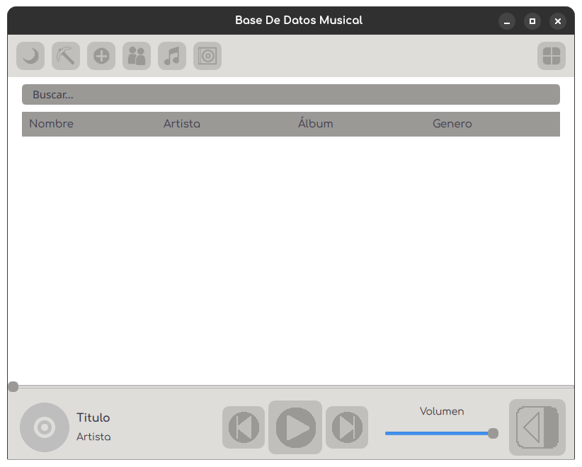

# MyP Proyecto 2 Base de Datos Musical

### Introducción

Este repositorio contiene la implementación de una base de datos que contiene la información de archivos MP3, cuyos metadatos se extraen recursivamente a partir de un directorio dado, además, se puede interactuar con la base de datos mediante una interfaz, sin necesidad de hacer uso de codigo SQL directamente.

El proyecto fue desarrollado en C++, haciendo uso de bibliotecas como *SQLite* para comunicarse con la base de datos, ya sea insertando datos, actualizado los mismos u obtenerlos.

Para la creación de la interfaz se hizo uso de el framework [**Qt**](https://www.qt.io/) y su lenguaje de marcado declarativo [**QML**](https://doc.qt.io/qt-6/qmlreference.html).

### Funciones

Mediante el uso de la interfaz, el usuario tiene la capacidad de:

- Minar directorios y poblar la base de datos con la información de archivos MP3.
- Editar la información de la base de datos.
- Eliminar información de la base de datos.
- Reproducir los archivos MP3 minados.
- Realizar busquedas de forma simple o avanzada.

### Requisitos

Las versiones indicadas solo son las utilizadas en el proyecto, no son las versiones minimas necesitadas para ejecutarlo.

Dentro de el proyecto se encuentran *wraps* para realizar directamente la instalación de las bibliotecas dentro de el directorio de el proyecto, sin necesidad de instalarlas directamente en el sistema, sin embargo, el tiempo de compilación normalmente es mayor, pues las dependencias también se compilan.

Las dependencias que se pueden instalar de esta forma son:

- [**GoogleTest**](https://github.com/google/googletest) (para pruebas unitarias).
- [**SQLite3**](https://www.sqlite.org/index.html)
- [**TagLib**](https://taglib.org/)
- [**utfcpp**](https://github.com/nemtrif/utfcpp) (para usar **TagLib**)

Si se desea instalar las dependencias dentro del sistema se puede realizar de la siguiente forma:

- En Debian / Ubuntu / Linux Mint:

```
# GoogleTest
sudo apt install libgtest-dev

# SQLite3
sudo apt install libsqlite3-dev

# TagLib
sudo apt install libtag1-dev

# utfcpp
sudo apt install libutfcpp-dev
```

- En Fedora:

```
# GoogleTest
sudo dnf install gtest-devel

# SQLite3
sudo dnf install sqlite-devel

# TagLib
sudo dnf install taglib-devel

# utfcpp
sudo dnf install utf8cpp-devel
```

#### Meson y Ninja

Para poder compilar y ejecutar las pruebas unitarias se hace uso de el sistema de construcción [**Meson (1.4.1)**](https://mesonbuild.com/), este hace uso del sistema de compilación [**Ninja (1.12.1)**](https://ninja-build.org/), de manera que se puede instalar de la siguente manera:

- En Debian / Ubuntu / Linux Mint:

```
sudo apt install meson ninja-build
```

- En Fedora:

```
sudo dnf install meson ninja-build
```

#### g++

Como el proyecto esta escrito en C++ hacemos uso del compilador **g++ (14.2.1)**, el cual se puede instalar mediante el paquete *build-essential*:

- En Debian / Ubuntu / Linux Mint:
 
```
sudo apt install build-essential
```

y de manera individual como:

```
sudo apt install g++
```

- En Fedora:

```
sudo dnf install gcc-c++
```

#### Qt

Para la creación de la interfaz grafica de usuario se usa [**Qt (6.8.2)**](https://www.qt.io/), es recomendable instalar el IDE [**QtCreator (15.0.0)**](https://www.qt.io/development/tools/qt-creator-ide) (aunque no es obligatorio para compilar el proyecto), junto con herramientas adicionales:

- En Debian / Ubuntu / Linux Mint:

```
sudo apt install qtcreator
sudo apt install qt6-base-dev
sudo apt install qt6-declarative-dev
sudo apt install qt6-tools-dev
sudo apt install qt6-tools-dev-tools
sudo apt install qml6-module-qtquick
sudo apt install qml6-module-qtquick-window
sudo apt install qml6-module-qtquick-controls
sudo apt install qml6-module-qtquick-layouts
sudo apt install qml6-module-qt-labs-qmlmodels
sudo apt install qml6-module-qtquick-effects
sudo apt install qt6-multimedia-dev
```

- En Fedora:

```
sudo dnf install qt-creator
sudo dnf install qt6-qtbase-devel
sudo dnf install qt6-qtdeclarative-devel
sudo dnf install qt6-qttools-devel
sudo dnf install qt6-qtmultimedia-devel
sudo dnf install qt6-qtquickcontrols2
```

Pueden hacer falta otros y pueden variar dependiendo de la distribución y su versión, sin embargo, su instalación es similar, o también se pueden descargar mediante [**Qt for Open Source Use**](https://www.qt.io/development/download-qt-installer-oss), aunque es necesario tener una cuenta Qt y esta version es diferente a la instalada mediante apt o dnf y se tiene que configurar para que el constructor pueda encontrar la dependencia.

Además puede ser necesario instalar XCB para ejecutar la interfaz.

- En Debian / Ubunto / Linux Mint:

```
sudo apt install libxcb-cursor0
```

- En Fedora:

```
sudo dnf install xcb-util-cursor
```

#### Doxygen

Por ultimo para poder generar la documentación del proyecto, se hizo uso de [**Doxygen (1.10.0)**](https://www.doxygen.nl/), el cual se puede instalar como:

- En Debian / Ubuntu / Linux Mint:

```
sudo apt install doxygen
```

- En Fedora:

```
sudo dnf install doxygen
```

### Compilación y pruebas unitarias

Primero es necesario clonar el repositorio.

```
git clone https://github.com/AngelGervacio/Proyecto2-BDMusical.git
```

Dentro de la carpeta del repositorio configuramos el proyecto con **Meson**.

```
meson setup build
```

Una vez configurado, podemos compilar el proyecto.

```
meson compile -C build
```

Despues de que se compile, tenemos que realizar la instalación de los archivos necesarios para la ejecución del proyecto en las rutas configuradas por el usuario en su sistema, dichos archivos se pueden encontrar en el directorio *sql*.

```
sudo meson install -C build
```

Despues de compilar y realizar la instalación, podemos ejecutar las pruebas unitarias.

```
meson test -C build
```

### Ejecución del proyecto

Una vez compilado el proyecto sin errores, se generan los ejecutables de el *Minero* y *BDMusical*.


#### Minero

El ejecutable recibe una bandera obligatoria y dos opcionales:

- **-d** *ruta del directorio a minar*
- **-b** *ruta donde se guarda la base de datos*
- **-h**

La bandera **-d** es obligatoria y va junto con la ruta del directorio que se minara, la bandera **-b** es opcional y se necesita especificar la ruta donde se guardara la base de datos , mientras que la bandera **-h** muestra un mensaje de ayuda.

Si solo se especifica la bandera **-d** se guardara la base de datos dentro de el sistema del usuario.

De manera que para ejecutarlo hacemos:

```
./build/src/Minero -d /ruta/
```

Para especificar la ruta de la base de datos.

```
./build/src/Minero -d /ruta/ -b /ruta/archivo.db
```

Y también

```
./build/src/Minero -h
```

#### BDMusical

Este ejecutable es la interfaz y no recibe ninguna bandera, tal que se ejecuta de la forma:

```
./build/src/gui/BDMusical
```

La interfaz permite interactuar con la base de datos, administrar los metadatos de las canciones y reproducir los archivos MP3.



> **Nota:** Algunos diálogos pueden presentar variaciones en su distribución dependiendo de la resolución y las dimensiones
> de la pantalla, es recomendable usar la interfaz en pantalla completa.

#### Búsquedas

La interfaz permite realizar búsquedas de dos formas:

- **Búsqueda libre:** permite buscar canciones mediante texto.
- **Búsqueda avanzada:** utiliza un lenguaje de consulta propio que permite combinar condiciones mediante operadores lógicos y de comparación.

Ejemplos de búsquedas avanzadas:

```
@@TITULO="Bohemian Rhapsody"&&ARTISTA="Queen"

@@AÑO>=2010

@@GENERO="Rock"||GENERO="Metal"
```

### Documentación

Para poder generar la documentación del proyecto hacemos uso de **Doxygen** y ejecutamos:

```
doxygen Doxyfile
```

Y para abrirlo en el navegador podemos usar la herramienta **xdg-open** tal que:

```
xdg-open docs/html/index.html
```

La pagina generada contendra la información de las clases asi como sus metodos implementados.

### Integración Continua

El proyecto hace uso de GitHub Actions pare configurar el proyecto, compilarlo, ejecutar pruebas unitarias y generar documentación cada vez que se realiza un **push** o un **pull request**.